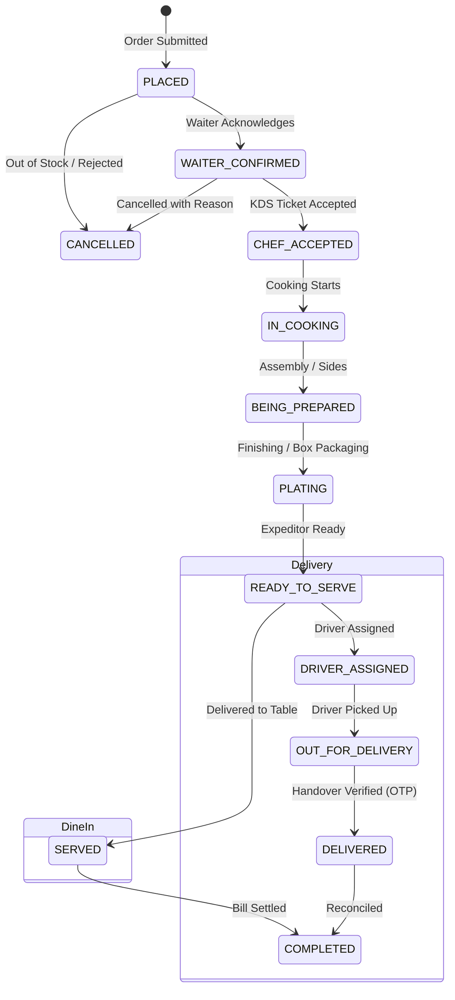

# Resto Platform - Order Lifecycle & State Machine Specification

---

## 1. Granular Order State Graph

The order state machine enforces deterministic, forward-progressing transitions with full audit logging:

---

## 2. Transition Validation Rules

| Current Status | Allowed Next Statuses | Actor Roles Allowed |
| :--- | :--- | :--- |
| `PLACED` | `WAITER_CONFIRMED`, `CHEF_ACCEPTED`, `CANCELLED` | `waiter`, `chef`, `manager`, `owner` |
| `WAITER_CONFIRMED` | `CHEF_ACCEPTED`, `IN_COOKING`, `CANCELLED` | `chef`, `manager`, `owner` |
| `CHEF_ACCEPTED` | `IN_COOKING`, `CANCELLED` | `chef`, `manager` |
| `IN_COOKING` | `BEING_PREPARED`, `PLATING`, `READY_TO_SERVE` | `chef` |
| `BEING_PREPARED` | `PLATING`, `READY_TO_SERVE` | `chef` |
| `PLATING` | `READY_TO_SERVE` | `chef`, `waiter` |
| `READY_TO_SERVE` | `SERVED` (Dine-in), `DRIVER_ASSIGNED` (Delivery) | `waiter`, `chef`, `manager` |
| `DRIVER_ASSIGNED` | `OUT_FOR_DELIVERY`, `CANCELLED` | `driver`, `manager` |
| `OUT_FOR_DELIVERY` | `DELIVERED` | `driver` (requires OTP verification) |
| `SERVED` / `DELIVERED` | `COMPLETED` | `waiter`, `manager`, `owner` |

Attempting any transition outside this matrix returns `422 Unprocessable Entity` with an explicit reason.
Every valid transition appends to `restoapp.order_status_history` and emits WebSocket updates.
